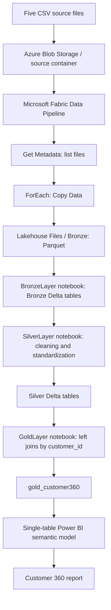
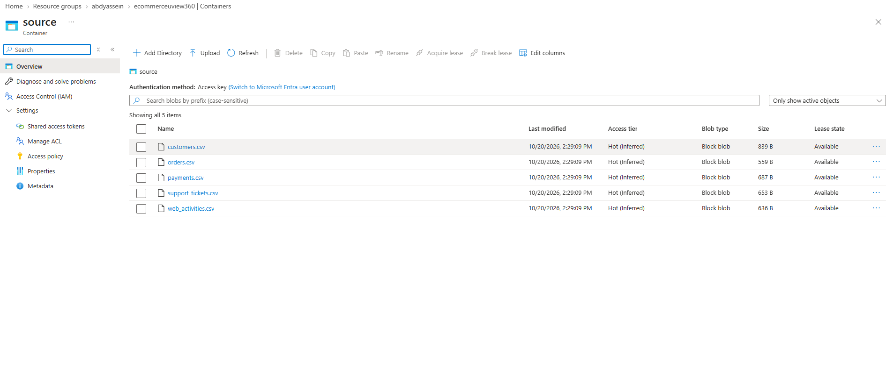
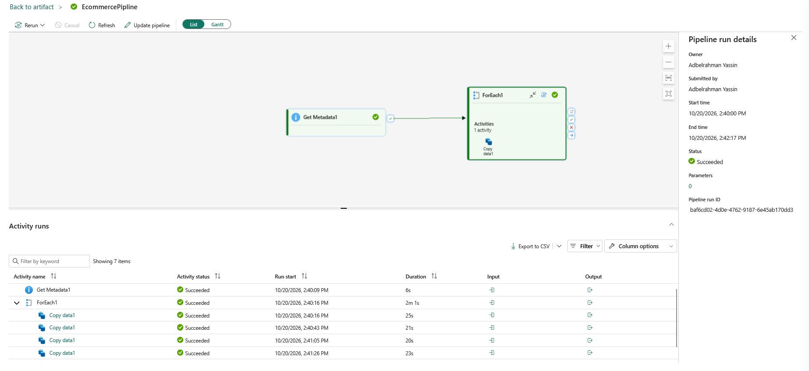
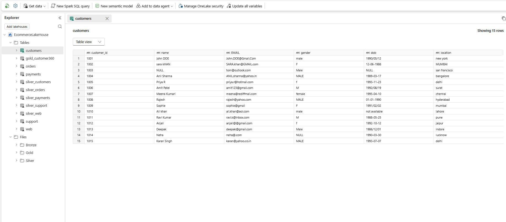
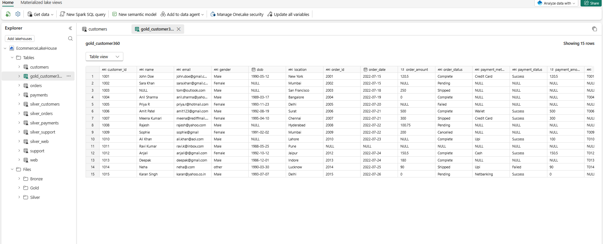
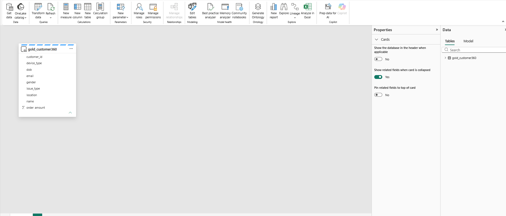
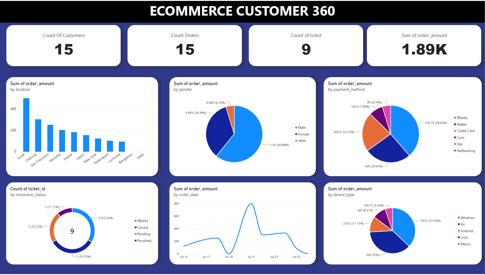

# E-commerce Customer 360 | Azure + Microsoft Fabric + PySpark + Power BI

An end-to-end learning project that integrates five e-commerce datasets into a unified customer analytics table. The workflow uses Azure Blob Storage for source files, Microsoft Fabric Data Pipeline for ingestion, a Fabric Lakehouse for Delta tables, PySpark notebooks for transformations, and Power BI for reporting.

> **Project status:** Implemented as a small-scale portfolio demonstration using 15 customer records. The current Gold model is a denormalized, joined table. See [Known limitations](#known-limitations-and-next-steps) before treating the report as a production-ready customer 360 solution.

## Business problem

Customer information is spread across CRM, orders, payments, support, and website analytics systems. Bringing these sources together allows analysts to inspect customer profiles, purchases, payment outcomes, support history, and web behavior in one reporting experience.

## Tech stack

- **Azure:** Resource Group, Storage Account, Blob Container (`source`)
- **Microsoft Fabric:** Workspace, Data Pipeline, Lakehouse, Notebooks, Semantic Model
- **Data processing:** PySpark, Delta Lake
- **Reporting:** Power BI
- **Source datasets:** CSV

## Architecture



## Source files

| Dataset | Typical information |
| --- | --- |
| `customers.csv` | Customer profile, email, date of birth, location |
| `orders.csv` | Order IDs, dates, amounts, statuses |
| `payments.csv` | Payment method, status, amount |
| `support_tickets.csv` | Support issue type, ticket date, resolution status |
| `web_activities.csv` | Web sessions, pages viewed, device type |

Each uploaded source CSV contains 15 records. These are demonstration files, not a representative production dataset.

## Implementation

### 1. Ingestion — Azure Blob Storage to Fabric

The CSV files are uploaded to an Azure Blob Storage container. The Fabric pipeline uses **Get Metadata** to obtain the file list, **ForEach** to iterate over the files, and **Copy Data** to land data in the Fabric Lakehouse. The Bronze notebook reads Parquet files from the Lakehouse `Files/Bronze` location.





### 2. Bronze — raw Delta tables

`notebooks/BronzeLayer.ipynb` reads the five Parquet datasets from OneLake and writes Delta tables named `customers`, `orders`, `payments`, `support`, and `web`.



### 3. Silver — PySpark cleaning

`notebooks/SilverLayer.ipynb` carries out source-specific transformations, including:

- Customer names, emails, genders and locations standardized; customer IDs deduplicated; rows missing customer ID or email dropped.
- Order dates parsed from several text formats; amounts cast to numeric; negative amounts set to null; order IDs deduplicated.
- Payment methods/status standardized; negative payment amounts set to null; records missing required fields dropped.
- Support issue type and resolution status standardized; ticket IDs deduplicated.
- Web page paths converted to lowercase; device types standardized; session IDs deduplicated.

The Silver tables are stored as Delta (`silver_customers`, `silver_orders`, `silver_payments`, `silver_support`, `silver_web`). **Important:** The notebook uses simple parsing and cleansing rules; not every ambiguous date or data-quality edge case is resolved.

### 4. Gold — joined customer view

`notebooks/GoldLayer.ipynb` joins the five Silver tables by `customer_id` using left joins, producing the `gold_customer360` Delta table. It combines profile, order, payment, ticket, and web-session attributes.



### 5. Power BI semantic model and report

The report uses a **single-table semantic model** based on `gold_customer360`, rather than a dimensional/star schema.



The demonstrated report includes customer count, order count, ticket count and sum of order amounts, with breakdowns by location, gender, payment method, ticket resolution status, order date, and device type.



[View the report PDF](docs/Ecommerce-Customer-360-Report.pdf)

## Repository contents

```text
Ecommerce-Customer-360/
├── README.md
├── .gitignore
├── data/                  # Five demo CSV source files
├── notebooks/             # Original Bronze, Silver, and Gold notebooks
├── docs/                  # All screenshots and the Power BI report PDF
├── VALIDATION_NOTES.md    # Checks and limitations to review
└── LINKEDIN_POST.md       # Draft project announcement
```

## How to reproduce

1. Create an Azure Storage Account and a Blob container; upload the five files in `data/`.
2. Create a Microsoft Fabric Workspace and Lakehouse.
3. Create a pipeline using **Get Metadata → ForEach → Copy Data** to ingest the CSV sources into the Lakehouse Bronze area, with Parquet outputs matching the Bronze notebook.
4. Attach the Lakehouse to each notebook, then run them in order: `BronzeLayer.ipynb`, `SilverLayer.ipynb`, `GoldLayer.ipynb`.
5. **Before running Bronze**, replace its hard-coded OneLake ABFSS paths (`EcommerceWorkSpce`, `EcommerceLakeHouse`) with those in your environment.
6. Create a Power BI semantic model using `gold_customer360`, then reproduce the report using the fields and measures appropriate to your model.

The pipeline configuration and editable Power BI `.pbix` file are **not** included in this repository; screenshots and a PDF document the original deployment. Microsoft Fabric capacity, permissions and Azure resources are required to execute the workflow.

## Known limitations and next steps

- **Join multiplication risk:** Gold joins independent one-to-many tables directly on `customer_id`. If a customer has multiple orders, tickets, payments or sessions, joins can multiply rows and inflate `SUM(order_amount)` and counts. Aggregate each source to customer grain first, or build a dimensional model with independent fact tables before relying on the KPIs.
- **Revenue not yet reconciled:** The report screenshot shows approximately `1.89K` for sum of order amounts; this value should be reconciled against the cleaned source with explicit rules for cancelled, failed, and refunded orders.
- **Date parsing:** Multiple source date conventions and ambiguous values need additional validation.
- **Payment relationships:** The demonstration payments file carries `customer_id` but not `order_id`; therefore, do not assume payment attempts are uniquely mapped to individual orders.
- **Small demo dataset:** No conclusions about real customer retention, churn, or high-value segments should be generalized from these samples.
- **Automation:** The pipeline ingestion is demonstrated; orchestrated execution of all three notebooks on a schedule is not included in the uploaded evidence.

See [VALIDATION_NOTES.md](VALIDATION_NOTES.md) for recommended checks.

## Security and publishing note

Only upload demonstrative, licensed, non-sensitive data. Never commit Azure access keys, SAS tokens, tenant credentials, or Fabric secrets. Verify that example contact information and names are approved for public distribution.
